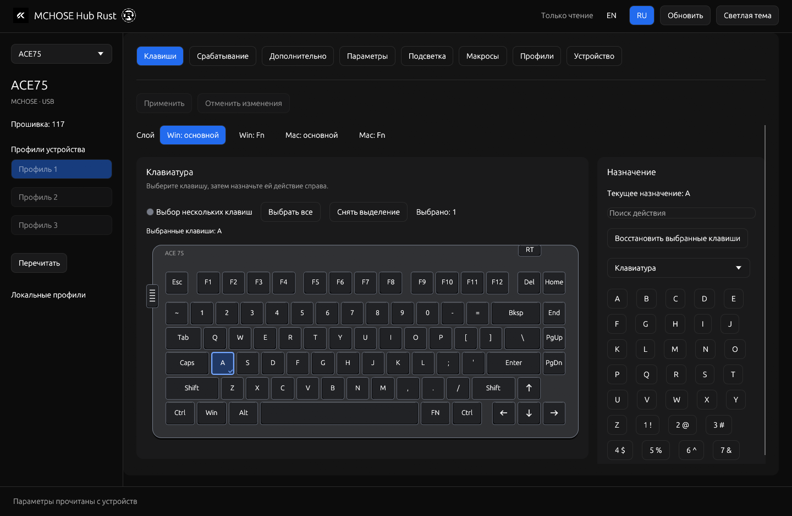
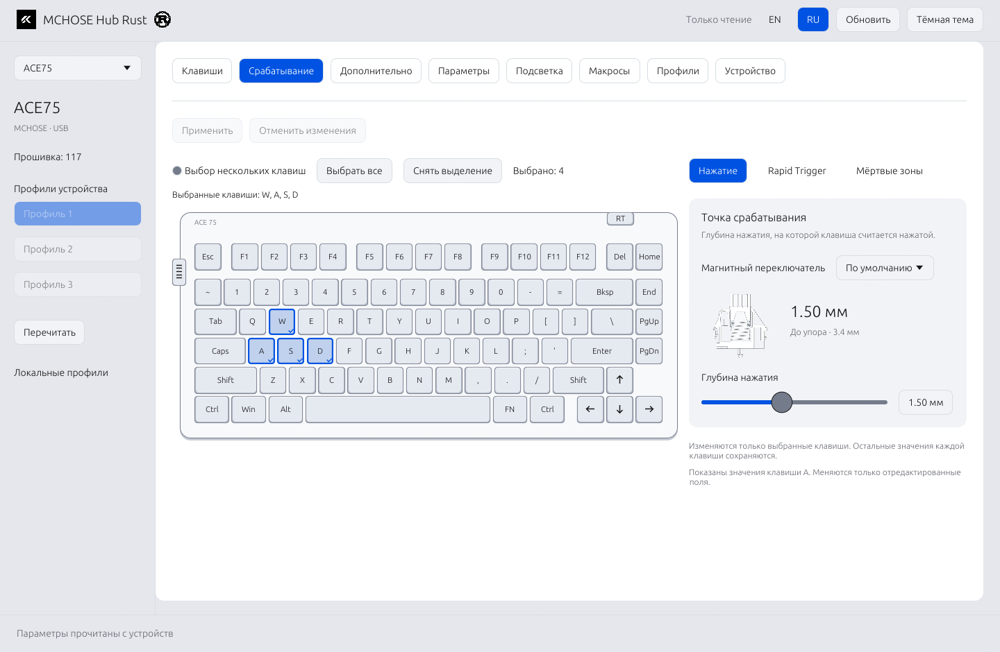

# MCHOSE Hub Rust

[Русский](README.ru.md)

An **open-source native alternative to MCHOSE Hub**, built in Rust for **MCHOSE A7 V3 Ultra+, MagDock and Ace 75 8K** on Windows and Linux. Built with egui/eframe and direct HID access. No browser engine, Electron, WebView or cloud account.

Developed through **reverse engineering** of the publicly distributed MCHOSE Hub web application, its HID protocol and official firmware. This is an independent project, not an official MCHOSE product.

[Download Windows and Linux packages](https://github.com/mansur54321/mchose-hub-rust/releases/latest).

## Screenshots

The native application on Linux:

| Dark theme | Light theme |
| --- | --- |
|  |  |
|  |  |

## Features

Select **A7 + MagDock** or **Ace75** in the native sidebar. Each device has its own settings and local library.

Ace75 has eight pages: keys, triggers, advanced actions, performance, lighting, macros, profiles and device information:

- Four key layers: Windows, Windows Fn, Mac and Mac Fn. Key, chord, media, mouse, macro and device actions; global RT single/double-click controls.
- Per-key actuation, Rapid Trigger press/release, precision, dead zones, switch selection, calibration and live travel monitoring.
- RS, SOCD, DKS, MT, TGL and LT advanced actions; 1/2/4/8 kHz polling and supported performance settings.
- Main, strip and logo lighting, per-position RGB colors and color calibration. Host music lighting and local static/animated themes, including GIF and image import.
- Onboard profile selection/order/names, local profiles and macro editing/recording, Hub JSON import/export and official firmware download/update.

See [Ace75 details, firmware gates and hardware test limits](docs/ace75.md). This support is for **Ace 75 8K (`3837:303c`)**, not the different 16K model. Animation and music playback require the application to remain running. Their native renderers reproduce the feature using the extracted protocol; pixel-identical output from the website's parent music/GIF bridge has not been established.

The existing A7 and MagDock controls include:

- Battery and charging state, connection type, active profile and DPI, firmware versions.
- Button assignments, keyboard shortcuts, multimedia controls and onboard macros.
- Up to six DPI stages, independent X/Y values and supported sensor/performance settings.
- Three onboard profiles, local profile and macro libraries, M HUB JSON import/export.
- MagDock effects, brightness, speed, color and direction.
- Music lighting from the system playback output; the microphone is not selected.
- Charging ring: half yellow at 50%, full green at 100%, with smooth color and partial-segment transitions. The previous effect resumes when external charging power is removed.
- Russian/English interface and light/dark themes.
- Official firmware download and verified transfer with explicit confirmation.

Device writes are read back and checked. Backups are saved before settings are replaced. Reset and firmware-transfer actions require confirmation in the application. Macro recording observes input delivered to the application's own window and stops on focus loss.

## Run

On Windows, launch `mchose-hub-rust.exe`. On Linux:

```sh
./mchose-hub-rust
```

The application must remain running for music lighting and the charging ring. The charging signal comes from the mouse, so the ring also works when the mouse charges through a cable while MagDock is connected.

```sh
mchose-hub-rust --lang en
mchose-hub-rust --lang ru
mchose-hub-rust --read-only
mchose-hub-rust --offline
mchose-hub-rust --status
mchose-hub-rust --snapshot
mchose-hub-rust --list
mchose-hub-rust --device ace75
mchose-hub-rust --device ace75 --snapshot
```

`--read-only` disables device writes. `--offline` opens the local editors without HID access. `--status` and `--snapshot` print JSON; the latter also reads the device configuration. `--help` lists the remaining options.

Supported USB identity: VID `3837`, mouse PIDs `4033`/`1014`/`1018` with the exact product name `MCHOSE A7 V3 Ultra+`, MagDock PID `1012`, Ace75 control PID `303c` and its firmware-upgrader PID `303d`. Only the keyboard's configuration collection is opened; ordinary keyboard input collections are not polled. Other devices sharing a PID are deliberately excluded. Bluetooth does not expose the mouse configuration interface used by this utility; Ace75 support is wired.

## Build

Install stable Rust and build from the repository root:

```sh
cargo build --release --locked
cargo test --all-targets --locked
```

Linux additionally needs the development libraries for `libudev`, Wayland/XKB and OpenGL. On Debian/Ubuntu:

```sh
sudo apt install build-essential pkg-config libudev-dev libxkbcommon-dev libwayland-dev libgl-dev
```

Linux music lighting uses `pw-dump` and `pw-cat` from PipeWire. Windows music lighting uses WASAPI loopback. Device access on Linux requires an appropriate `hidraw` permission rule; the GUI should run as the regular user.

Install a built Linux application in the current user's menu:

```sh
python3 scripts/install-local.py
```

Build output is `target/release/mchose-hub-rust` on Linux and `target/release/mchose-hub-rust.exe` on Windows. The local `egui-winit` patch preserves physical key events for the macro recorder; see [its scope and licenses](vendor/egui-winit/MCHOSE-PATCH.md).

## Data and profiles

Local data is stored in the application's platform data directory. It contains `backups/`, `presets/`, `macros/` and saved UI preferences. Ace75 has its own `ace75/` subtree. Linux uses `${XDG_DATA_HOME:-$HOME/.local/share}/mchose-native`; Windows uses the local application-data directory.

The existing `mchose-native` data directory and Linux command alias are retained for compatibility with earlier builds.

Profiles and macros can be imported from M HUB JSON. If a profile references a macro only by name, import that macro into the local library first. Missing definitions stop an import before any device write. The application does not overwrite existing export files.

Ace75's macro bank can be shared by onboard profiles. Profile imports reuse identical macros or allocate empty slots; they stop before writing if a definition is missing or no free slot exists. Keyboard profiles and lighting themes use separate formats. Save a lighting theme with a `.hub.json` filename to export the Hub lighting format.

## Bundled firmware

The [firmware directory](firmware) contains eight unmodified official images for the mouse, both receiver variants, MagDock and Ace75 8K. [The manifest](firmware/manifest.json) records their source URLs, sizes and SHA-256 digests.

Main/Sub are the two controllers **inside one selected device**, not a mouse/receiver pair. Firmware transfer checks the exact device role and file contents against the official CDN, so an internet connection is required for that check. MagDock versions below 0003 require the manufacturer's separate transition utility.

Ace75 uses a single full BIN and a separate USB bootloader. The application checks the 8K model, observes re-enumeration, verifies transfer replies and reads the returned firmware version. No Ace75 firmware flash or recovery has been tested on physical hardware.

See [firmware findings and limitations](docs/firmware.md) and [validation](docs/verification.md). A successful build or transfer receipt does not prove an update succeeded on physical hardware.

## Project scope

This is an independent implementation based on the publicly distributed MCHOSE Hub and captured device responses. It supports local device configuration; cloud accounts, shared online profiles, theme stores and other device models are outside its scope.

The MCHOSE logo, illustrations and firmware remain third-party materials. Origins and dependency notices are recorded in [NOTICES.md](NOTICES.md). Local desktop captures, device backups, browser profiles and research toolchains are excluded from the repository.

The project's original code is available under the [MIT License](LICENSE). Third-party artwork, firmware and vendored dependencies retain their own terms.
