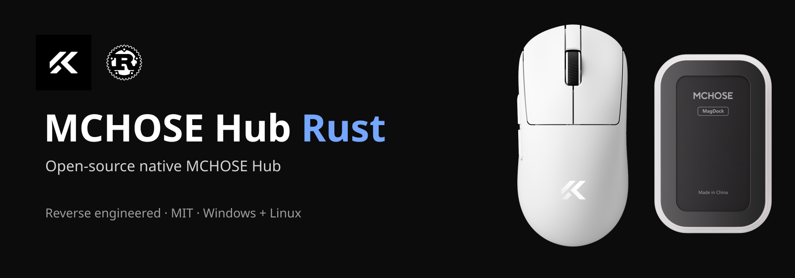
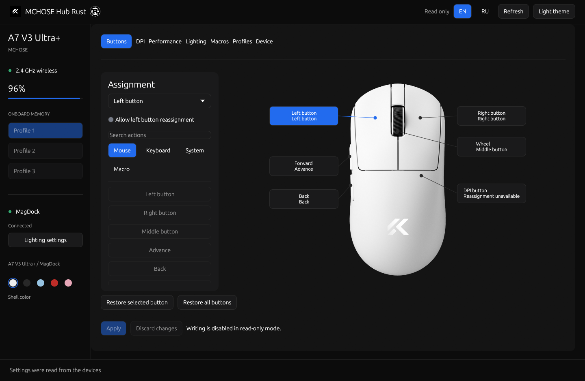
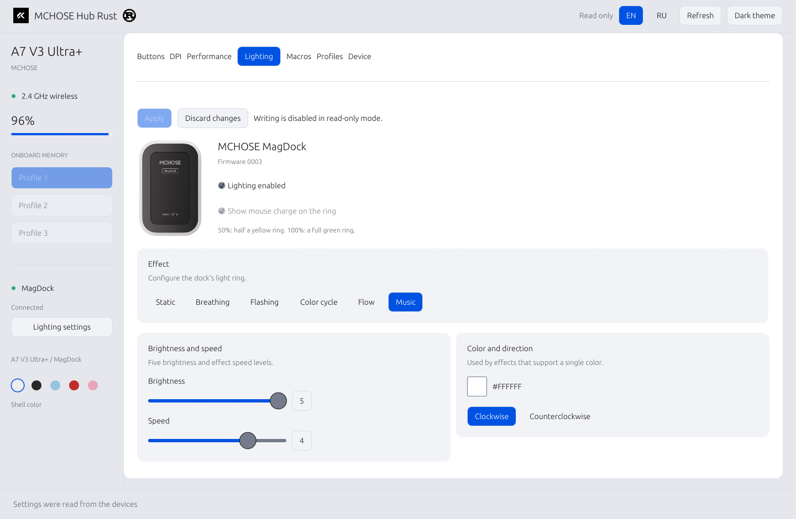

# MCHOSE Hub Rust

[English](README.md)

**Open-source альтернатива MCHOSE Hub** на Rust для **MCHOSE A7 V3 Ultra+ и MagDock** под Windows и Linux. Интерфейс — egui/eframe, доступ к устройствам — через HID. Для работы не нужны браузерный движок, Electron, WebView или облачный аккаунт.

Создано путём **реверс-инжиниринга (reverse engineering)** веб-версии MCHOSE Hub, HID-протокола и официальных прошивок. Это независимый проект, не официальное приложение MCHOSE.

[Скачать сборки Windows и Linux](https://github.com/mansur54321/mchose-hub-rust/releases/latest).

## Скриншоты

Реальное нативное приложение под Linux:

| Тёмная тема | Светлая тема / MagDock |
| --- | --- |
|  |  |

## Возможности

- Состояние батареи, зарядка, подключение, активные профиль и DPI, версии прошивок.
- Назначения кнопок, сочетания клавиш, мультимедиа и аппаратные макросы.
- До шести ступеней DPI, отдельные оси X/Y, поддерживаемые настройки сенсора и производительности.
- Три аппаратных профиля, локальные библиотеки, импорт/экспорт JSON M HUB.
- Эффекты, яркость, скорость, цвет и направление подсветки MagDock.
- Музыкальная подсветка по системному звуку; микрофон не выбирается.
- Кольцо заряда: 50% — половина жёлтая, 100% — всё зелёное. После отключения зарядного питания возвращается прежний эффект.
- Переключение русского/английского языка, светлая и тёмная темы.
- Загрузка официальных прошивок и проверяемая передача с отдельным подтверждением.

После записи программа перечитывает параметры с устройства. Перед заменой настроек сохраняется резервная копия. Запись макросов получает события только собственного окна и останавливается при потере фокуса.

## Запуск

В Windows запустите `mchose-hub-rust.exe`, в Linux — `./mchose-hub-rust`.

```sh
mchose-hub-rust --lang ru
mchose-hub-rust --lang en
mchose-hub-rust --read-only
mchose-hub-rust --offline
mchose-hub-rust --status
mchose-hub-rust --snapshot
```

Музыкальная подсветка и кольцо заряда требуют открытого приложения. Признак зарядки поступает от мыши, поэтому кольцо работает и при зарядке кабелем, если MagDock подключён.

Поддерживаются VID `3837`, PID мыши `4033`/`1014`/`1018` с точным именем `MCHOSE A7 V3 Ultra+` и MagDock PID `1012`. Bluetooth не предоставляет нужный интерфейс настройки.

## Сборка

```sh
cargo build --release --locked
cargo test --all-targets --locked
```

В Linux нужны библиотеки разработки `libudev`, Wayland/XKB и OpenGL; для музыкального режима — `pw-dump` и `pw-cat`. В Windows используется WASAPI loopback. Нужные права на `hidraw` в Linux настраиваются отдельно; запускать интерфейс от root не требуется.

Установка готовой Linux-сборки в меню пользователя:

```sh
python3 scripts/install-local.py
```

Результат сборки: `target/release/mchose-hub-rust` в Linux, `target/release/mchose-hub-rust.exe` в Windows. Локальные данные Linux находятся в `${XDG_DATA_HOME:-$HOME/.local/share}/mchose-native`, Windows — в локальном каталоге данных приложений.

## Прошивки и проверки

В [firmware](firmware) включены семь неизменённых официальных образов. Источники и SHA-256: [manifest.json](firmware/manifest.json). Main/Sub — два контроллера внутри выбранного устройства. Для передачи программа сверяет модель, назначение файлов и их содержимое с официальным CDN; этой проверке нужен интернет.

[Разбор протокола и ограничения](docs/firmware.md), [проверки](docs/verification.md), [происхождение сторонних материалов](NOTICES.md).

Это самостоятельное приложение совместимости. Облачные аккаунты, публикация настроек в M HUB, магазин тем и управление другими моделями в проект не входят.

Собственный код проекта распространяется по [лицензии MIT](LICENSE). Сторонние изображения, прошивки и зависимости сохраняют свои условия лицензирования. Каталог данных `mchose-native` и старая команда Linux сохранены для совместимости с предыдущими сборками.
